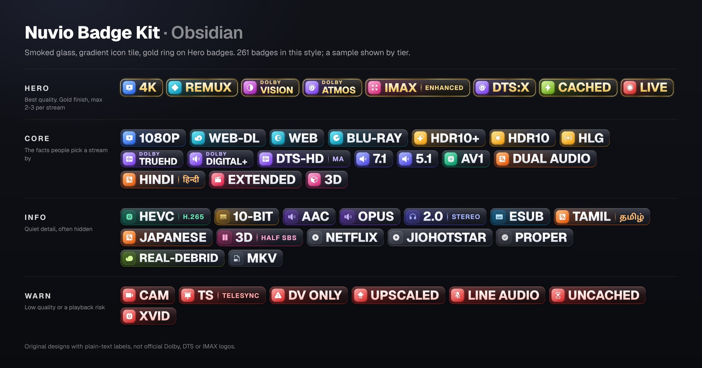
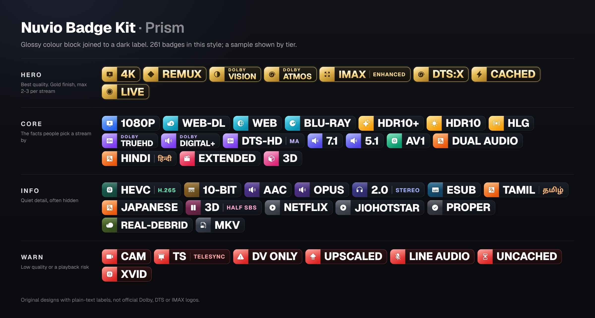
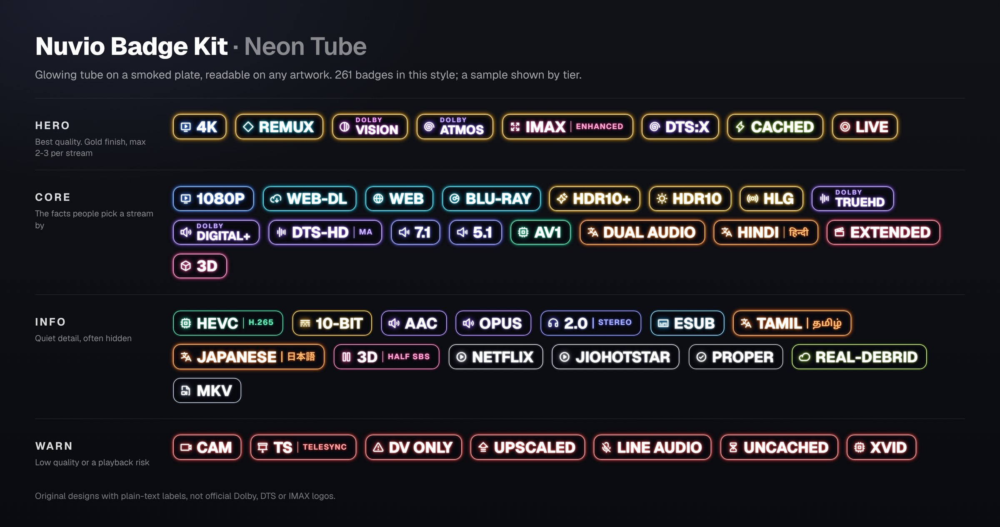
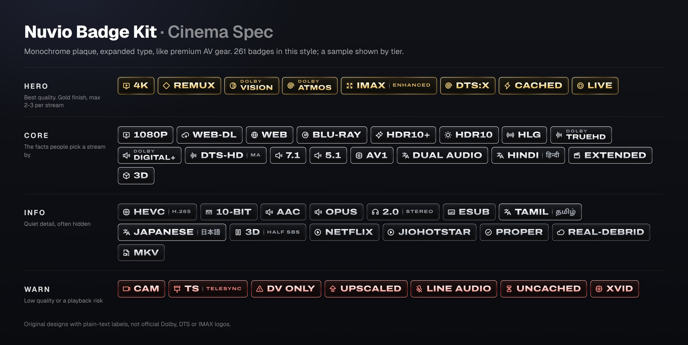
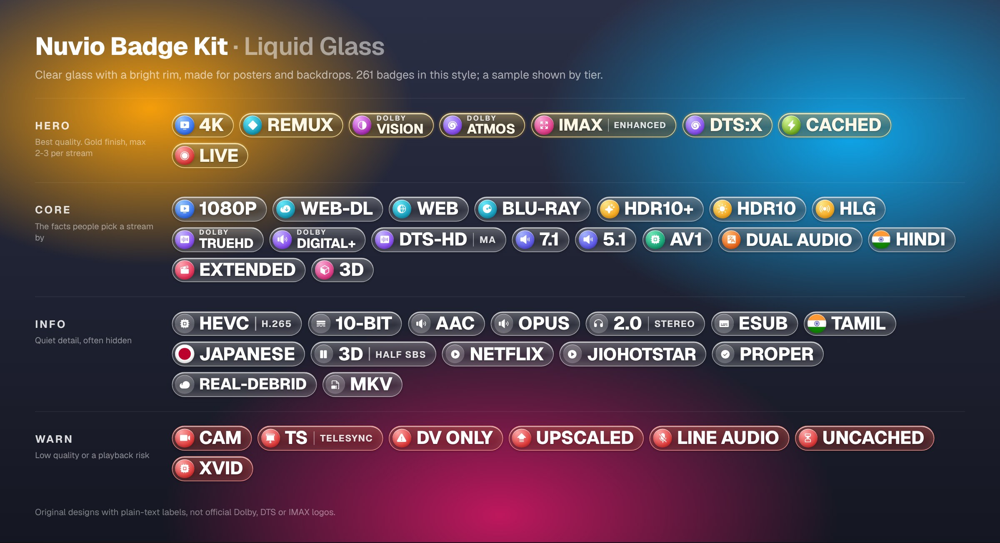
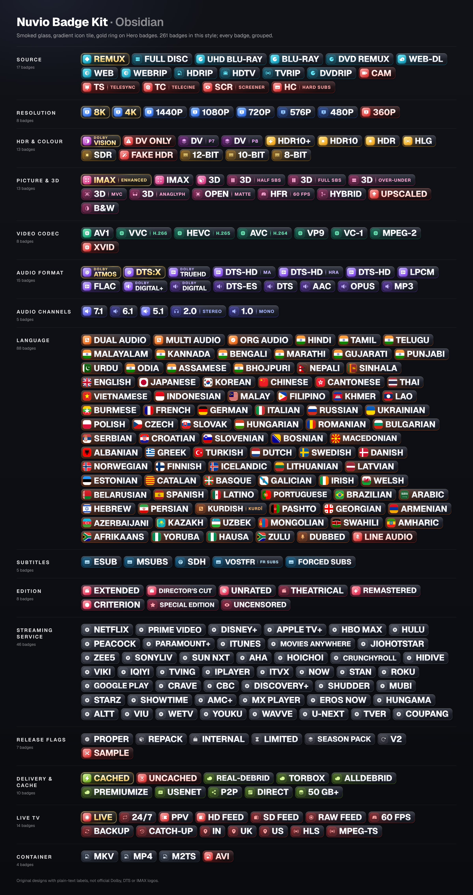
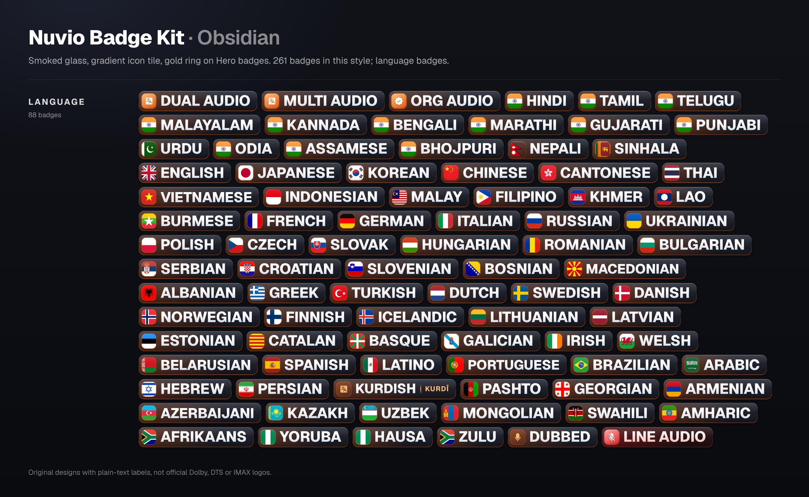

# Nuvio Badge Kit

261 stream badges in 5 styles for Nuvio: quality, HDR, audio, 83 languages, streaming services and Live TV, plus red warnings for CAM rips and bad copies.

## How to install

1. Pick a style below and copy its link.
2. In Nuvio, open **Profile → Layout → Streams → Fusion badge URLs**.
3. Paste the link, then open any stream list.

To switch styles later, paste the new link and restart Nuvio.

## Styles

### Obsidian



```
https://raw.githubusercontent.com/jyotiprakash101/nuvio-badge-kit/main/obsidian.json
```

### Prism



```
https://raw.githubusercontent.com/jyotiprakash101/nuvio-badge-kit/main/prism.json
```

### Neon



```
https://raw.githubusercontent.com/jyotiprakash101/nuvio-badge-kit/main/neon.json
```

### Cinema



```
https://raw.githubusercontent.com/jyotiprakash101/nuvio-badge-kit/main/cinema.json
```

### Liquid



```
https://raw.githubusercontent.com/jyotiprakash101/nuvio-badge-kit/main/liquid.json
```

## Extra files

Every style has two more files. Add the same ending to your style's link:

- **`-live.json`** adds Live TV badges. Paste it as a second link.
- **`-full.json`** also shows codecs, bit depth, services and release flags.

## Every badge





## Colours

- **Gold:** the best quality (REMUX, 4K, Dolby Vision, Atmos, Cached).
- **Red:** a warning (CAM, telesync, upscaled, Dolby Vision with no HDR fallback).
- **Other colours** show the group: blue for resolution, amber for HDR, violet for audio, orange for language.

## Something wrong?

- **No badges:** check the link starts with `raw.githubusercontent.com`, then restart Nuvio.
- **Old badges still show:** clear Nuvio's cache.
- **A badge is wrong or missing:** [open an issue](../../issues) with the stream's full title.

## Make it your own

Fork this repo and change `"isEnabled"` in a style's file to turn badges on or off, then use your fork's link. To change the designs, see [source](source/README.md).

## Credits

Icons by [Phosphor](https://phosphoricons.com) (MIT). Fonts: Geist, Archivo and Noto Sans (SIL Open Font Licence). Tag research from [AIOStreams](https://github.com/Viren070/AIOStreams) and [TRaSH Guides](https://trash-guides.info). Not affiliated with Dolby, DTS, IMAX or any streaming service. Released under the MIT licence.
