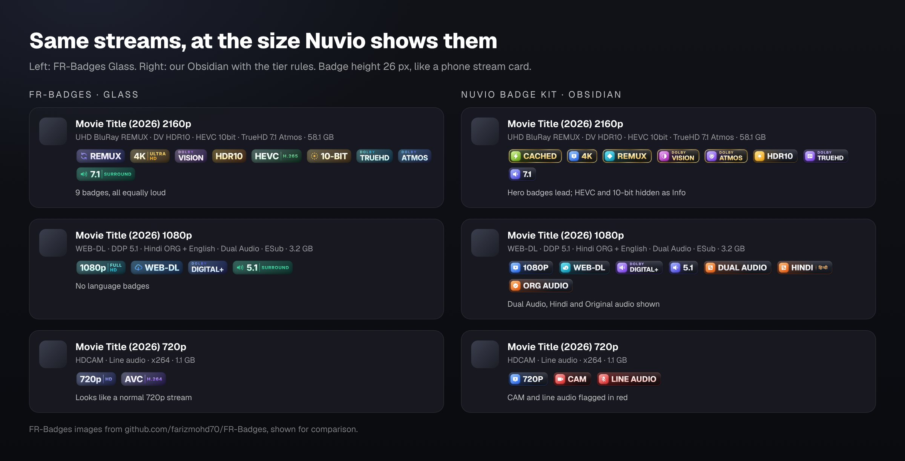

# Nuvio Badge Kit

**261 stream badges in 5 styles for [Nuvio](https://github.com/NuvioMedia) (and any app that reads Fusion badge files).** Gold badges point you to the best copies, red ones warn you about CAM rips and broken HDR, and 83 languages appear in their own script.


## Contents

- [Why this kit](#why-this-kit)
- [Quick start](#quick-start)
- [Pick a style](#pick-a-style)
- [Which file do I use?](#which-file-do-i-use)
- [How the tiers work](#how-the-tiers-work)
- [What's included](#whats-included)
- [How a badge decides to show](#how-a-badge-decides-to-show)
- [Customise it](#customise-it)
- [Troubleshooting](#troubleshooting)
- [Files in this repo](#files-in-this-repo)
- [Credits and licence](#credits-and-licence)

## Why this kit

Most badge packs cover 25 to 35 badges and make every one equally loud. This kit is built differently:

- **It covers everything a stream title can tell you.** Source and quality, resolution, HDR and Dolby Vision profiles, 3D and IMAX, codecs, audio formats and channels, 83 languages, subtitles, editions, 46 streaming services, release flags, debrid cache status, Live TV and containers.
- **Badges have tiers.** The few that matter most (REMUX, 4K, Dolby Vision, Atmos, Cached) get a gold finish, and details like codec or bit depth stay quiet. Your eye lands on the best stream first.
- **It warns you.** CAM, telesync, screener, hard-coded subs, upscaled video, fake HDR, Dolby Vision without an HDR fallback, line audio and uncached torrents all show in red.
- **Languages read naturally.** Hindi shows हिन्दी, Tamil shows தமிழ், Arabic shows العربية, Japanese shows 日本語, and so on.
- **The patterns are tested.** Every pattern is checked against sample stream titles in both Python and JavaScript, the engine Nuvio's mobile, web and TV apps use.
- **It's light.** Images are WebP at about 13 to 50 KB each, so lists load fast even on TV sticks.
- **The art is original.** Labels are plain text; there are no official Dolby, DTS, IMAX or streaming-service logos.



## Quick start

1. In Nuvio, open **Profile → Layout → Streams → Fusion badge URLs**.
2. Paste this link (the Obsidian style, recommended file):
   ```
   https://raw.githubusercontent.com/jyotiprakash101/nuvio-badge-kit/main/obsidian.json
   ```
3. Go back to any title's stream list. Badges appear on each stream.

If you watch Live TV, paste `https://raw.githubusercontent.com/jyotiprakash101/nuvio-badge-kit/main/obsidian-live.json` into a second slot.

Switching styles later? Replace the link, then restart Nuvio or clear its cache so the old images go away.

## Pick a style

Every style contains all 261 badges and works the same way. Only the look changes.

| Style | Look | Preview | File |
|---|---|---|---|
| **Obsidian** | Smoked glass, gradient icon tile, gold ring on Hero badges. The all-rounder. | [Preview](previews/preview-obsidian.jpg) | `obsidian.json` |
| **Prism** | A glossy colour block joined to a dark label. Fastest to scan. | [Preview](previews/preview-prism.jpg) | `prism.json` |
| **Neon** | Glowing tubes on a smoked plate, readable on any artwork. | [Preview](previews/preview-neon.jpg) | `neon.json` |
| **Cinema** | Monochrome plaque with wide lettering, like premium AV gear. | [Preview](previews/preview-cinema.jpg) | `cinema.json` |
| **Liquid** | Clear glass with a bright rim, made for posters and backdrops. | [Preview](previews/preview-liquid.jpg) | `liquid.json` |

### Links to paste

**Obsidian**

```
https://raw.githubusercontent.com/jyotiprakash101/nuvio-badge-kit/main/obsidian.json
```

Everything on: `https://raw.githubusercontent.com/jyotiprakash101/nuvio-badge-kit/main/obsidian-full.json`  
Live TV: `https://raw.githubusercontent.com/jyotiprakash101/nuvio-badge-kit/main/obsidian-live.json`

**Prism**

```
https://raw.githubusercontent.com/jyotiprakash101/nuvio-badge-kit/main/prism.json
```

Everything on: `https://raw.githubusercontent.com/jyotiprakash101/nuvio-badge-kit/main/prism-full.json`  
Live TV: `https://raw.githubusercontent.com/jyotiprakash101/nuvio-badge-kit/main/prism-live.json`

**Neon**

```
https://raw.githubusercontent.com/jyotiprakash101/nuvio-badge-kit/main/neon.json
```

Everything on: `https://raw.githubusercontent.com/jyotiprakash101/nuvio-badge-kit/main/neon-full.json`  
Live TV: `https://raw.githubusercontent.com/jyotiprakash101/nuvio-badge-kit/main/neon-live.json`

**Cinema**

```
https://raw.githubusercontent.com/jyotiprakash101/nuvio-badge-kit/main/cinema.json
```

Everything on: `https://raw.githubusercontent.com/jyotiprakash101/nuvio-badge-kit/main/cinema-full.json`  
Live TV: `https://raw.githubusercontent.com/jyotiprakash101/nuvio-badge-kit/main/cinema-live.json`

**Liquid**

```
https://raw.githubusercontent.com/jyotiprakash101/nuvio-badge-kit/main/liquid.json
```

Everything on: `https://raw.githubusercontent.com/jyotiprakash101/nuvio-badge-kit/main/liquid-full.json`  
Live TV: `https://raw.githubusercontent.com/jyotiprakash101/nuvio-badge-kit/main/liquid-live.json`

## Which file do I use?

Each style comes as three files. Nuvio accepts up to three badge links, so you can combine them.

| File | What's on | Use it when |
|---|---|---|
| `<style>.json` | Hero, Core and Warn badges, plus Indian languages, English, Japanese, Korean and Chinese (73 of 243 badges) | You want clean rows. Start here. |
| `<style>-full.json` | All 243 badges | You want every detail, including codec, bit depth, services, release flags and all 83 languages. |
| `<style>-live.json` | 18 Live TV and container badges | You use Live TV channels. Add it as a second link. |

Use one style at a time. Mixing styles works, but the rows look inconsistent.

## How the tiers work

| Tier | Look | Badges |
|---|---|---|
| **Hero** | Gold ring or gold finish | REMUX, 8K, 4K, Dolby Vision, IMAX Enhanced, Dolby Atmos, DTS:X, Cached, LIVE |
| **Core** | Full colour | What people pick a stream by: 1080p, WEB-DL, Blu-ray, HDR10, TrueHD, DD+, 5.1, AV1, Dual Audio, Hindi, Extended and more |
| **Info** | Softer icon tile | Useful detail: HEVC, 10-bit, AAC, services, release flags. Off in the recommended file. |
| **Warn** | Red | CAM, Telesync, Telecine, Screener, hard-coded subs, DV only (no HDR fallback), fake HDR, upscaled, XviD, low resolution, line audio, uncached, samples, AVI |

Colour also tells you the group: blue for resolution, amber for HDR, violet for audio, orange for language, cyan for source, green for codec, pink for 3D and IMAX.

## What's included

| Group | Badges |
|---|---|
| Source | 17 |
| Resolution | 8 |
| HDR & Colour | 13 |
| Picture & 3D | 13 |
| Video Codec | 8 |
| Audio Format | 15 |
| Audio Channels | 5 |
| Language | 88 |
| Subtitles | 5 |
| Edition | 8 |
| Streaming Service | 46 |
| Release Flags | 7 |
| Delivery & Cache | 10 |
| Live TV | 14 |
| Container | 4 |
| **Total** | **261** |

See them all in one picture: [every badge in the Obsidian style](previews/catalogue.jpg) and [all language badges](previews/languages.jpg). Or open a group to see every badge and whether it's on in the recommended file:

<details>
<summary><b>Source</b> (17 badges)</summary>

| Badge | Tier | On in recommended file |
|---|---|---|
| REMUX | Hero | Yes |
| FULL DISC | Info | No |
| UHD Blu-ray | Core | Yes |
| Blu-ray | Core | Yes |
| DVD REMUX | Info | No |
| WEB-DL | Core | Yes |
| WEB | Core | Yes |
| WEBRip | Core | Yes |
| HDRip | Info | No |
| HDTV | Info | No |
| TVRip / SATRip | Info | No |
| DVDRip | Info | No |
| CAM | Warn | Yes |
| Telesync | Warn | Yes |
| Telecine | Warn | Yes |
| Screener | Warn | Yes |
| Hard-coded subs | Warn | Yes |

</details>

<details>
<summary><b>Resolution</b> (8 badges)</summary>

| Badge | Tier | On in recommended file |
|---|---|---|
| 8K | Hero | Yes |
| 4K | Hero | Yes |
| 1440P | Core | Yes |
| 1080P | Core | Yes |
| 720P | Core | Yes |
| 576P | Info | No |
| 480P | Info | No |
| Low res | Warn | Yes |

</details>

<details>
<summary><b>HDR & Colour</b> (13 badges)</summary>

| Badge | Tier | On in recommended file |
|---|---|---|
| Dolby Vision | Hero | Yes |
| DV only (no fallback) | Warn | Yes |
| DV Profile 7 | Info | No |
| DV Profile 8 | Info | No |
| HDR10+ | Core | Yes |
| HDR10 | Core | Yes |
| HDR | Core | Yes |
| HLG | Core | Yes |
| SDR | Info | No |
| Fake HDR | Warn | Yes |
| 12-BIT | Info | No |
| 10-BIT | Info | No |
| 8-BIT | Info | No |

</details>

<details>
<summary><b>Picture & 3D</b> (13 badges)</summary>

| Badge | Tier | On in recommended file |
|---|---|---|
| IMAX Enhanced | Hero | Yes |
| IMAX | Core | Yes |
| 3D | Core | Yes |
| 3D Half-SBS | Info | No |
| 3D Full SBS | Info | No |
| 3D Over-Under | Info | No |
| 3D MVC | Info | No |
| Anaglyph | Info | No |
| Open Matte | Info | No |
| HFR 60 FPS | Info | No |
| HYBRID | Info | No |
| UPSCALED | Warn | Yes |
| Black & White | Info | No |

</details>

<details>
<summary><b>Video Codec</b> (8 badges)</summary>

| Badge | Tier | On in recommended file |
|---|---|---|
| AV1 | Core | Yes |
| VVC H.266 | Info | No |
| HEVC H.265 | Info | No |
| AVC H.264 | Info | No |
| VP9 | Info | No |
| VC-1 | Info | No |
| MPEG-2 | Info | No |
| XviD / DivX | Warn | Yes |

</details>

<details>
<summary><b>Audio Format</b> (15 badges)</summary>

| Badge | Tier | On in recommended file |
|---|---|---|
| Dolby Atmos | Hero | Yes |
| DTS:X | Hero | Yes |
| TrueHD | Core | Yes |
| DTS-HD MA | Core | Yes |
| DTS-HD HRA | Core | Yes |
| DTS-HD | Core | Yes |
| LPCM | Core | Yes |
| FLAC | Core | Yes |
| Dolby Digital Plus | Core | Yes |
| Dolby Digital | Info | No |
| DTS-ES | Info | No |
| DTS | Info | No |
| AAC | Info | No |
| Opus | Info | No |
| MP3 | Info | No |

</details>

<details>
<summary><b>Audio Channels</b> (5 badges)</summary>

| Badge | Tier | On in recommended file |
|---|---|---|
| 7.1 Surround | Core | Yes |
| 6.1 Surround | Info | No |
| 5.1 Surround | Core | Yes |
| 2.0 Stereo | Info | No |
| 1.0 Mono | Info | No |

</details>

<details>
<summary><b>Language</b> (88 badges)</summary>

| Badge | Tier | On in recommended file |
|---|---|---|
| Dual Audio | Core | Yes |
| Multi Audio | Core | Yes |
| Original audio | Core | Yes |
| Hindi (हिन्दी) | Core | Yes |
| Tamil (தமிழ்) | Core | Yes |
| Telugu (తెలుగు) | Core | Yes |
| Malayalam (മലയാളം) | Core | Yes |
| Kannada (ಕನ್ನಡ) | Core | Yes |
| Bengali (বাংলা) | Core | Yes |
| Marathi (मराठी) | Core | Yes |
| Gujarati (ગુજરાતી) | Core | Yes |
| Punjabi (ਪੰਜਾਬੀ) | Core | Yes |
| Urdu (اردو) | Core | Yes |
| Odia (ଓଡ଼ିଆ) | Core | Yes |
| Assamese (অসমীয়া) | Core | Yes |
| Bhojpuri (भोजपुरी) | Core | Yes |
| Nepali (नेपाली) | Core | Yes |
| Sinhala (සිංහල) | Core | Yes |
| English | Core | Yes |
| Japanese (日本語) | Core | Yes |
| Korean (한국어) | Core | Yes |
| Chinese (中文) | Core | Yes |
| Cantonese (粵語) | Info | No |
| Thai (ไทย) | Info | No |
| Vietnamese (TIẾNG VIỆT) | Info | No |
| Indonesian (BAHASA) | Info | No |
| Malay (MELAYU) | Info | No |
| Filipino (TAGALOG) | Info | No |
| Khmer (ខ្មែរ) | Info | No |
| Lao (ລາວ) | Info | No |
| Burmese (မြန်မာ) | Info | No |
| French (FRANÇAIS) | Info | No |
| German (DEUTSCH) | Info | No |
| Italian (ITALIANO) | Info | No |
| Russian (РУССКИЙ) | Info | No |
| Ukrainian (УКРАЇНСЬКА) | Info | No |
| Polish (POLSKI) | Info | No |
| Czech (ČEŠTINA) | Info | No |
| Slovak (SLOVENČINA) | Info | No |
| Hungarian (MAGYAR) | Info | No |
| Romanian (ROMÂNĂ) | Info | No |
| Bulgarian (БЪЛГАРСКИ) | Info | No |
| Serbian (SRPSKI) | Info | No |
| Croatian (HRVATSKI) | Info | No |
| Slovenian (SLOVENŠČINA) | Info | No |
| Bosnian (BOSANSKI) | Info | No |
| Macedonian (МАКЕДОНСКИ) | Info | No |
| Albanian (SHQIP) | Info | No |
| Greek (ΕΛΛΗΝΙΚΑ) | Info | No |
| Turkish (TÜRKÇE) | Info | No |
| Dutch (NEDERLANDS) | Info | No |
| Swedish (SVENSKA) | Info | No |
| Danish (DANSK) | Info | No |
| Norwegian (NORSK) | Info | No |
| Finnish (SUOMI) | Info | No |
| Icelandic (ÍSLENSKA) | Info | No |
| Lithuanian (LIETUVIŲ) | Info | No |
| Latvian (LATVIEŠU) | Info | No |
| Estonian (EESTI) | Info | No |
| Catalan (CATALÀ) | Info | No |
| Basque (EUSKARA) | Info | No |
| Galician (GALEGO) | Info | No |
| Irish (GAEILGE) | Info | No |
| Welsh (CYMRAEG) | Info | No |
| Belarusian (БЕЛАРУСКАЯ) | Info | No |
| Spanish (ESPAÑOL) | Info | No |
| Latino (LATAM) | Info | No |
| Portuguese (PORTUGUÊS) | Info | No |
| Brazilian (PT-BR) | Info | No |
| Arabic (العربية) | Info | No |
| Hebrew (עברית) | Info | No |
| Persian (فارسی) | Info | No |
| Kurdish (KURDÎ) | Info | No |
| Pashto (پښتو) | Info | No |
| Georgian (ქართული) | Info | No |
| Armenian (ՀԱՅԵՐԵՆ) | Info | No |
| Azerbaijani (AZƏRBAYCAN) | Info | No |
| Kazakh (ҚАЗАҚ) | Info | No |
| Uzbek (OʻZBEK) | Info | No |
| Mongolian (МОНГОЛ) | Info | No |
| Swahili (KISWAHILI) | Info | No |
| Amharic (አማርኛ) | Info | No |
| Afrikaans | Info | No |
| Yoruba (YORÙBÁ) | Info | No |
| Hausa | Info | No |
| Zulu (ISIZULU) | Info | No |
| DUBBED | Info | Yes |
| Line / cam audio | Warn | Yes |

</details>

<details>
<summary><b>Subtitles</b> (5 badges)</summary>

| Badge | Tier | On in recommended file |
|---|---|---|
| ESub | Info | No |
| MSubs | Info | No |
| SDH | Info | No |
| VOSTFR (French subs) | Info | No |
| FORCED SUBS | Info | No |

</details>

<details>
<summary><b>Edition</b> (8 badges)</summary>

| Badge | Tier | On in recommended file |
|---|---|---|
| EXTENDED | Core | Yes |
| Director's Cut | Core | Yes |
| UNRATED | Core | Yes |
| THEATRICAL | Info | No |
| REMASTERED | Core | Yes |
| CRITERION | Core | Yes |
| Special / Anniversary | Info | No |
| UNCENSORED | Info | No |

</details>

<details>
<summary><b>Streaming Service</b> (46 badges)</summary>

| Badge | Tier | On in recommended file |
|---|---|---|
| NETFLIX | Info | No |
| Prime Video | Info | No |
| Disney+ | Info | No |
| Apple TV+ | Info | No |
| HBO Max | Info | No |
| Hulu | Info | No |
| Peacock | Info | No |
| Paramount+ | Info | No |
| iTunes | Info | No |
| Movies Anywhere | Info | No |
| JioHotstar | Info | No |
| ZEE5 | Info | No |
| SonyLIV | Info | No |
| Sun NXT | Info | No |
| aha | Info | No |
| Hoichoi | Info | No |
| Crunchyroll | Info | No |
| HIDIVE | Info | No |
| Viki | Info | No |
| iQIYI | Info | No |
| TVING | Info | No |
| BBC iPlayer | Info | No |
| ITVX | Info | No |
| NOW | Info | No |
| Stan | Info | No |
| Roku | Info | No |
| Google Play | Info | No |
| Crave | Info | No |
| CBC | Info | No |
| Discovery+ | Info | No |
| Shudder | Info | No |
| MUBI | Info | No |
| Starz | Info | No |
| Showtime | Info | No |
| AMC+ | Info | No |
| MX Player | Info | No |
| Eros Now | Info | No |
| Hungama | Info | No |
| ALTBalaji / ALTT | Info | No |
| Viu | Info | No |
| WeTV | Info | No |
| Youku | Info | No |
| Wavve | Info | No |
| U-NEXT | Info | No |
| TVer | Info | No |
| Coupang Play | Info | No |

</details>

<details>
<summary><b>Release Flags</b> (7 badges)</summary>

| Badge | Tier | On in recommended file |
|---|---|---|
| PROPER | Info | No |
| REPACK | Info | No |
| INTERNAL | Info | No |
| LIMITED | Info | No |
| Season pack | Info | No |
| Anime v2 / Batch | Info | No |
| Sample / Extras | Warn | Yes |

</details>

<details>
<summary><b>Delivery & Cache</b> (10 badges)</summary>

| Badge | Tier | On in recommended file |
|---|---|---|
| Cached | Hero | Yes |
| Uncached | Warn | Yes |
| Real-Debrid | Info | No |
| TorBox | Info | No |
| AllDebrid | Info | No |
| Premiumize | Info | No |
| USENET | Info | No |
| P2P | Info | No |
| DIRECT | Info | No |
| Big file 50 GB+ | Info | No |

</details>

<details>
<summary><b>Live TV</b> (14 badges)</summary>

| Badge | Tier | On in recommended file |
|---|---|---|
| LIVE | Hero | Yes |
| 24/7 | Info | No |
| PPV | Core | Yes |
| HD feed | Core | Yes |
| SD feed | Info | No |
| RAW FEED | Info | No |
| 50/60 fps feed | Info | No |
| BACKUP | Info | No |
| Catch-up | Info | No |
| Region IN | Info | No |
| Region UK | Info | No |
| Region US | Info | No |
| HLS | Info | No |
| MPEG-TS | Info | No |

</details>

<details>
<summary><b>Container</b> (4 badges)</summary>

| Badge | Tier | On in recommended file |
|---|---|---|
| MKV | Info | No |
| MP4 | Info | No |
| M2TS | Info | No |
| AVI | Warn | Yes |

</details>

## How a badge decides to show

Each badge is a pattern (a regular expression) that Nuvio runs against the stream's title and description. If the words are there, the badge shows. So a badge can only show what the addon writes: if an addon never mentions the audio language, no language badge appears.

Some examples, using real-style stream titles:

| Stream title | Badges shown |
|---|---|
| `Movie 2026 2160p UHD BluRay REMUX DV HDR10 HEVC TrueHD 7.1 Atmos \| 58.1 GB` | REMUX, 4K, Dolby Vision, HDR10, HEVC, TrueHD, Atmos, 7.1, 50 GB+ |
| `Movie 2026 2160p NF WEB-DL DDP5.1 Atmos DV H 265 \| 7.0 GB` | Netflix, WEB-DL, 4K, DD+, Atmos, Dolby Vision, **DV only**, 5.1, HEVC |
| `Movie (2026) Hindi ORG 1080p WEB-DL Dual Audio [Hindi + English] DD+5.1 ESub` | Hindi, Org Audio, 1080p, WEB-DL, Dual Audio, English, DD+, 5.1, ESub |
| `Movie 2026 HDCAM 720p x264 Line Audio` | **CAM**, 720p, AVC, **Line Audio** |
| `Pelicula 2026 1080p WEB-DL Español Latino DD5.1` | Latino (not Spanish), 1080p, WEB-DL, DD, 5.1 |
| `Movie 2026 1080p WEB-DL Multi 🇬🇧 / 🇪🇸 / 🇫🇷 / 🇩🇪 / 🇮🇹` | Multi, English, Spanish, French, German, Italian, 1080p, WEB-DL |

Details that avoid common mistakes:

- **File sizes aren't channels.** `5.1 GB` never shows a 5.1 badge, and `7.0 GB` never turns a 5.1 stream into 7.1.
- **Words in other contexts are skipped.** "Web Series" isn't a WEB release, "Eng Sub" isn't English audio, and "Multi Sub" isn't multi-audio.
- **Short service tags are case-sensitive.** `NF`, `MA`, `iT`, `CR` and `iP` only match in capitals and in the right spot, so `MA` (Movies Anywhere) never fires on `DTS-HD MA`.
- **Dolby Vision without HDR10 shows a warning.** Streams tagged DV with no HDR word are often profile 5, which shows pink and green colours on TVs without Dolby Vision.
- **Flags count only when they point to one language.** 🇯🇵 means Japanese; 🇮🇳 is skipped because it can mean many Indian languages.
- **Spanish variants stay apart.** Latino and Castellano are separate badges, and so are Brazilian and European Portuguese.

Languages are matched by English name, native name, safe ISO codes and flag emoji. The list covers all 48 languages AIOStreams recognises in stream names, plus regional ones such as Bhojpuri, Odia, Assamese, Sinhala, Cantonese, Khmer and Amharic.

## Customise it

**Turn badges on or off.** Fork this repo, open the style's JSON file and change `"isEnabled": false` to `true` (or the reverse) for the badges you want. Then use your fork's raw link in Nuvio. For example, set Spanish and French to `true` if you watch those dubs.

**Change the order.** The files list groups in the order people choose a stream: cache status, resolution, HDR, picture, audio, channels, source, language, then the rest. Reorder the `groups` and `filters` lists to change it.

**Fix a pattern.** Each badge's `pattern` field is a normal regular expression. Patterns starting with `(?i)` ignore upper and lower case.

**Make your own style.** Everything is generated from the `source` folder:

```
cd source
npm install                       # icons and fonts, from package.json
pip install playwright pillow && playwright install chromium
python3 render.py obsidian        # renders every badge as PNG into out/
python3 test_world.py && node test_node.mjs   # checks the patterns
python3 manifests.py https://raw.githubusercontent.com/YOU/YOUR-REPO/main webp ..
```

`spec.py` lists every badge (label, icon, tier, pattern), `languages.py` the languages, and `render.py` the five styles as plain CSS.

## Troubleshooting

**No badges appear.** Check that you pasted the raw link (it starts with `raw.githubusercontent.com`), then restart Nuvio.

**Old badges still show after switching styles.** Nuvio caches images. Restart the app or clear its cache.

**Too many badges on a stream.** Use the recommended `<style>.json` instead of `-full`, or turn off groups you don't need.

**A badge is wrong or missing.** Open an issue with the full stream title from your addon. Patterns are easy to adjust once the exact text is known.

**A badge shows for a word in a movie's name.** A few titles contain tag words, such as the film *Cam* or *Uncut Gems*. Badges can't tell a title from a tag, so these rare cases may show an extra badge.

## Files in this repo

```
obsidian.json, obsidian-full.json, obsidian-live.json   (and the same for prism, neon, cinema, liquid)
Obsidian/  Prism/  Neon/  Cinema/  Liquid/              261 WebP images per style
previews/                                               the images used in this README
source/                                                 generator, badge list, pattern tests
```

## Credits and licence

- Icons: [Phosphor Icons](https://phosphoricons.com) (MIT licence).
- Fonts: [Geist](https://vercel.com/font) and [Archivo](https://fonts.google.com/specimen/Archivo), plus [Noto Sans](https://fonts.google.com/noto) for every script (all SIL Open Font Licence).
- Tag research: [AIOStreams](https://github.com/Viren070/AIOStreams) and [TRaSH Guides](https://trash-guides.info).

Badge labels are plain text. Dolby, Dolby Vision, Dolby Atmos, DTS, IMAX and the streaming-service names are trademarks of their owners; this project isn't affiliated with any of them.

The kit is released under the MIT licence: use it, change it and share it, with credit.
